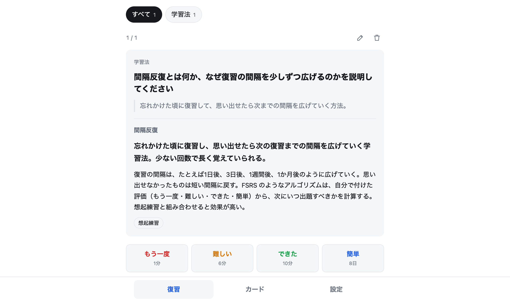
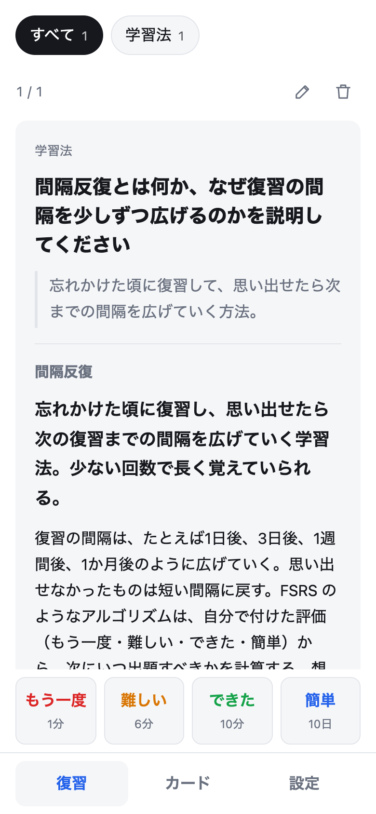
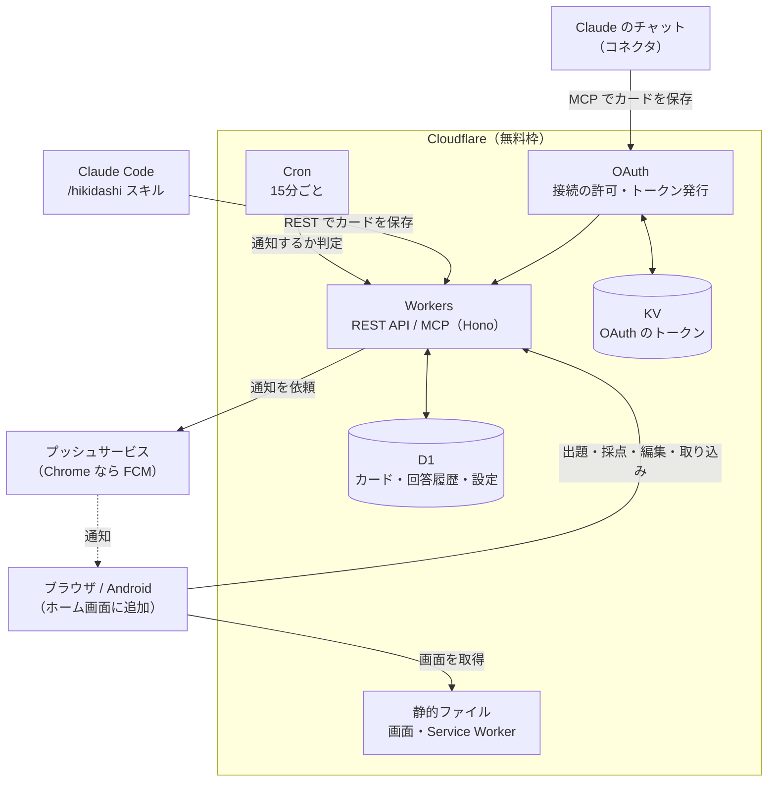
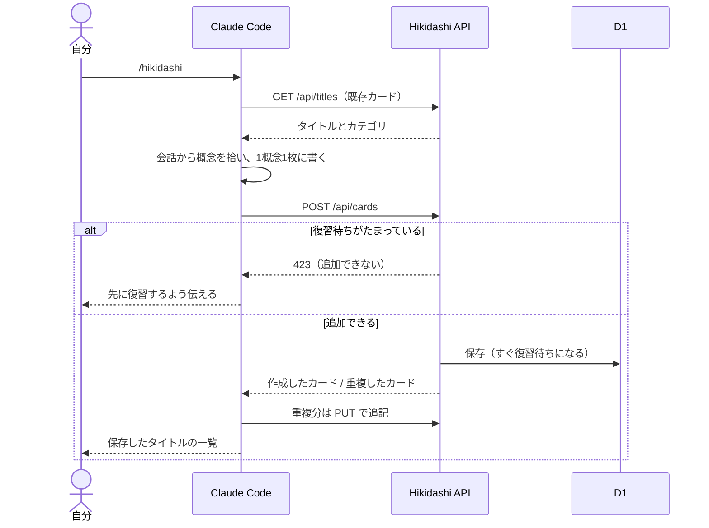
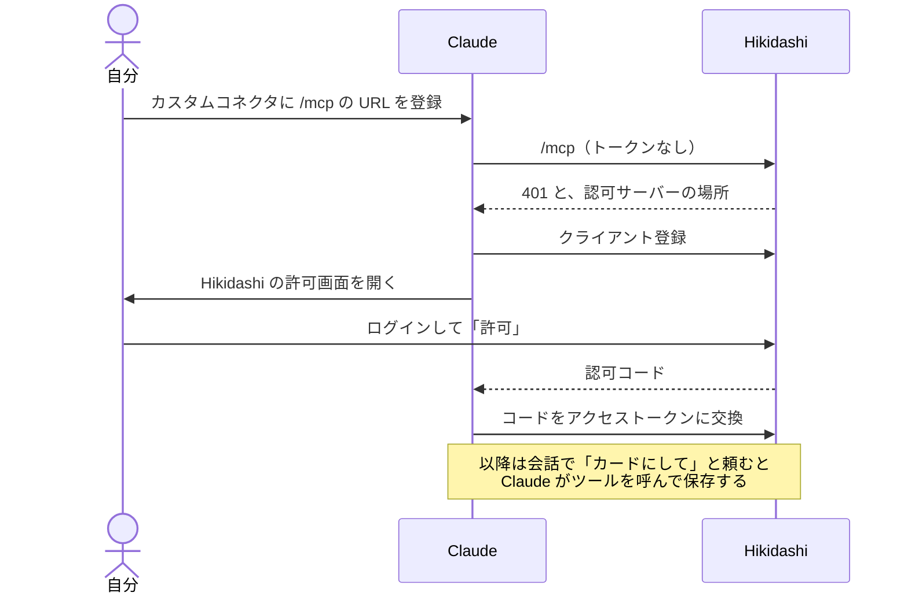
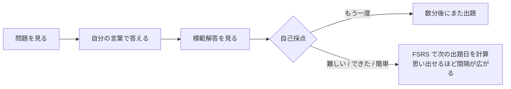
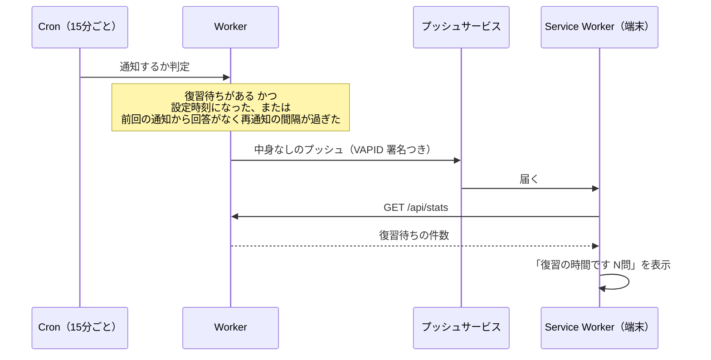

# Hikidashi

AIとのチャットで学んだことを、1概念1枚のカードにして復習するWebアプリ。

チャットは流れていき、読み返しても知識は定着しにくい。Hikidashi では、わからなかった用語や概念をカードとして1か所にしまい、忘れかけた頃に出題して**自分の言葉で思い出す**ことで定着させる。名前は、知識をしまう「引き出し」と、記憶から「引き出す」練習の両方から。

<p align="center">
  
  
</p>

## できること

| 機能 | 内容 |
| --- | --- |
| カードの保存 | 会話から概念を拾ってカードにする。既存カードとの関連付けや、同じ概念への追記も自動。保存の方法は3つ（下の表） |
| 復習 | 問題に自分の言葉で答えてから模範解答を見て、「もう一度 / 難しい / できた / 簡単」で自己採点する。カテゴリで絞り込める |
| 図解 | 流れ・構造・比較を問うカードには、Mermaid の図が付く。答えを見た後にだけ表示する |
| 深掘り | 答えを見てもわからないときは「質問する」で、カードの内容入りで Claude を開く。時間がなければ「あとで調べる」の印を付けておき、あとで Claude に一覧を出してもらう |
| 出題間隔の計算 | 採点結果から、次にいつ出題するかを [FSRS](https://github.com/open-spaced-repetition/ts-fsrs) で計算する |
| 通知 | 設定した時刻に、復習待ちがあればスマホやPCに通知する。回答しないままだと再通知する |
| 追加の制限 | 復習待ちがたまると、新しいカードを追加できなくなる。覚える量より復習を優先させるため |
| 書き出し | 全カードを Markdown で書き出せる |

### カードを保存する3つの方法

| 方法 | 使う場面 | 操作 |
| --- | --- | --- |
| Claude のチャット（コネクタ） | PC・Android の Claude アプリ | 会話の中で「カードにして」と頼む |
| Claude Code（`/hikidashi` スキル） | 開発中の会話 | `/hikidashi` と打つ |
| 貼り付けで取り込み | 会社の Claude、ChatGPT など他の AI、Claude の契約をやめた後 | 取り込み画面でプロンプトをコピーしてチャットに貼り、返ってきた JSON を貼り付ける。Android では返答を Hikidashi に共有するだけでよい |

## 構成



- **画面**はビルド不要の素の HTML / CSS / JavaScript（`public/`）。Workers の静的ファイル配信で返す
- **API** は Hono で書いた Worker（`src/`）。画面からは `/api/*` の REST API を、Claude のチャットからは `/mcp` の MCP サーバーを使う。どちらも同じカード保存処理（`src/cards.ts`）を通る
- **認証**は2種類。画面と Claude Code はログイン用のトークン（`APP_TOKEN`）、Claude のチャットは OAuth で発行したアクセストークンを使う。OAuth は [workers-oauth-provider](https://github.com/cloudflare/workers-oauth-provider) に任せている
- **データ**はすべて D1 に入る。Claude の契約とは独立しているので、契約をやめても残る

## 主な流れ

### Claude Code から保存する



### Claude のチャットとつなぐ

コネクタを最初に登録するときだけ、Hikidashi の許可画面が開く。Hikidashi にログイン済みのブラウザでしか許可できないので、URL を知っているだけの他人は接続できない。



MCP サーバーが Claude に渡すツールは5つ。

| ツール | 内容 |
| --- | --- |
| `get_existing_cards` | 既存カードのタイトルとカテゴリ、復習待ちの件数 |
| `save_cards` | カードを保存する。カードの書き方の指示もツールの説明に入っている |
| `get_flagged_cards` | 「あとで調べる」の印を付けたカードの一覧 |
| `get_card` | タイトルからカードの中身を取得する |
| `update_card` | 既存カードに追記する。深掘りが済んだカードの印も外す |

### 復習する



各ボタンには次に出題されるまでの間隔が表示される。

答えの下には「質問する」と「あとで調べる」がある。「質問する」はカードの問題・答え・説明・図を入れた質問文をコピーし、Claude の新しいチャットを開く（URL で文章を渡せない場合は貼り付ける）。わかったことは、そのチャットで Claude にコネクタ経由でカードへ追記してもらう。図のあるカードは、答えを見た後に説明の下へ図を表示する。図を描く Mermaid は大きいので、図のあるカードを開いたときに初めて読み込む。描画に失敗した図は表示せず、説明文だけを残す。復習中に内容の誤りに気づいたら、その場で編集・削除できる。

### 通知する

プッシュには中身を載せず、受け取った Service Worker が件数を取りに行って通知を組み立てる。中身がないので暗号化が要らず、VAPID の署名だけで送れる。



## ディレクトリ

```
hikidashi/
├── src/
│   ├── index.ts        REST API・出題間隔の計算・通知の判定・OAuth の設定
│   ├── cards.ts        カードと設定の読み書き（REST と MCP で共通）
│   ├── mcp.ts          MCP サーバー（Claude のチャットから使うツール）
│   ├── authorize.ts    コネクタ接続時の許可画面
│   ├── guide.ts        カードの書き方（MCP のツール説明と取り込み用プロンプトで共通）
│   └── push.ts         Web Push の送信（VAPID 署名）
├── public/             画面（ビルド不要）
│   ├── index.html
│   ├── app.js          復習・カード・設定の各画面
│   ├── style.css
│   ├── sw.js           Service Worker（通知の受信と表示）
│   └── manifest.webmanifest
├── migrations/         D1 のテーブル定義
├── skill/hikidashi/    Claude Code の /hikidashi スキル
├── scripts/            VAPID 鍵とアイコンの生成
└── wrangler.jsonc      Cloudflare の設定
```

## セットアップ

### ローカルで動かす

```bash
npm install
npm run gen:vapid > .dev.vars
echo "APP_TOKEN=$(openssl rand -base64 24 | tr '+/' '-_' | tr -d '=')" >> .dev.vars
echo "APP_URL=http://localhost:8787" >> .dev.vars
npm run db:migrate:local
npm run dev
```

`http://localhost:8787` を開き、`.dev.vars` の `APP_TOKEN` でログインする。通知の判定は次のコマンドで手動実行できる。

```bash
curl "http://localhost:8787/__scheduled?cron=*/15+*+*+*+*"
```

### Cloudflare にデプロイする

```bash
npx wrangler login
npx wrangler d1 create hikidashi         # 出力された database_id を wrangler.jsonc に書く
npx wrangler kv namespace create OAUTH_KV  # 出力された id を wrangler.jsonc の kv_namespaces に書く
npm run db:migrate
npm run gen:vapid                       # 出力された2つの値を次の secret に入れる
npx wrangler secret put VAPID_PUBLIC_KEY
npx wrangler secret put VAPID_PRIVATE_KEY
npx wrangler secret put APP_TOKEN       # ログイン用の長いランダム文字列
npm run deploy
```

デプロイ後に表示された URL を `wrangler.jsonc` の `vars.APP_URL` に書き、もう一度 `npm run deploy` する。

### スマホで使う

1. Android の Chrome でデプロイした URL を開き、`APP_TOKEN` でログインする
2. メニューの「ホーム画面に追加」でアプリとして置く
3. 設定画面で通知をオンにし、「テスト」で届くか確かめる

### Claude のチャットとつなぐ

1. Claude の設定画面の「コネクタ」から、カスタムコネクタを追加する
2. URL に `https://hikidashi.<subdomain>.workers.dev/mcp` を入れて接続する
3. 開いた Hikidashi の画面で、ログインして「許可」を押す

PC で登録すれば Android の Claude アプリでも使える。会話の中で「カードにして」と頼むと保存される。最後に使ってから90日たつと接続が切れるので、その場合はもう一度接続する。

### 貼り付けで取り込む

1. Hikidashi の「カード」→「取り込む」で「プロンプトをコピー」を押す。既存のカテゴリとタイトルが入った指示文がコピーされる
2. 学んだ会話の続きにそのまま貼って送ると、カードが JSON のコードブロックで返ってくる
3. コードブロックをコピーして取り込み画面の「貼り付け」を押し、内容を確認して保存する

Android では、ホーム画面に追加した Hikidashi が共有メニューに出る。AI の返答を Hikidashi に共有すると、取り込み画面が開いて中身が入った状態になる。

### /hikidashi スキルを使えるようにする

```bash
ln -s "$(pwd)/skill/hikidashi" ~/.claude/skills/hikidashi
mkdir -p ~/.config/hikidashi
```

`~/.config/hikidashi/config` に接続情報を書く。トークンを含むので、自分だけが読めるようにしておく（`chmod 600`）。

```
HIKIDASHI_URL=https://hikidashi.<subdomain>.workers.dev
HIKIDASHI_TOKEN=<APP_TOKEN と同じ値>
```

## 秘匿情報の置き場所

リポジトリには含めない。

| 値 | 本番 | ローカル |
| --- | --- | --- |
| `APP_TOKEN`（ログイン用） | Cloudflare の secret | `.dev.vars` |
| `VAPID_PUBLIC_KEY` / `VAPID_PRIVATE_KEY`（通知用） | Cloudflare の secret | `.dev.vars` |
| Claude のコネクタ用のアクセストークン | KV（ハッシュ化して保存） | ー |
| `HIKIDASHI_TOKEN`（スキル用） | ー | `~/.config/hikidashi/config` |

## 費用

Cloudflare の無料枠で収まる。上限を超えても無料プランでは請求されず、その日のリクエストがエラーになるだけ。

| 使っているもの | 無料枠の目安 | 使用量の目安 |
| --- | --- | --- |
| Workers | 1日10万リクエスト | 1日数十〜数百 |
| D1 | 5GB、読み取り1日500万行 | カード数千枚で数MB |
| KV | 読み取り1日10万回、書き込み1日1,000回 | コネクタの利用時だけ。1日数十回 |
| Cron | 無料プランで利用可 | 1日96回 |
| プッシュ通知 | 無料 | ー |

採点は自己採点なので、AI の API 料金もかからない。

## API

すべて `Authorization: Bearer <APP_TOKEN>` か、ログイン時に発行される Cookie が必要。

| メソッド | パス | 内容 |
| --- | --- | --- |
| POST | `/api/login` | トークンでログインし、Cookie を発行する |
| GET | `/api/stats` | 復習待ちの件数、カテゴリ別の件数、追加が止まっているか |
| GET | `/api/titles` | 全カードのタイトルとカテゴリ |
| GET | `/api/cards?q=&category=&flagged=` | カード一覧。`flagged=1` で印の付いたカードだけ |
| POST | `/api/cards` | カードを作成する（1枚または配列）。復習待ちがたまっていると 423 |
| GET / PUT / DELETE | `/api/cards/:id` | カードの取得・更新・削除 |
| PUT | `/api/cards/:id/flag` | `{ flagged }` で「あとで調べる」の印を付け外しする |
| GET | `/api/review?category=` | 復習待ちのカード。採点ごとの次回間隔つき |
| POST | `/api/cards/:id/review` | `{ rating: 1〜4, response }` で採点する |
| GET / PUT | `/api/settings` | 通知時刻・再通知・問題数・追加停止の設定 |
| GET | `/api/export.md` | 全カードを Markdown で書き出す |
| GET | `/api/push/key` | 通知の購読に使う公開鍵 |
| POST | `/api/push/subscribe` / `/api/push/unsubscribe` | 通知の購読・解除 |
| POST | `/api/push/test` | テスト通知を送る |
| GET | `/api/import-prompt` | 貼り付け取り込み用のプロンプト（既存のカテゴリとタイトル入り） |
| POST | `/mcp` | MCP サーバー。OAuth のアクセストークンか `APP_TOKEN` が必要 |

OAuth 用に `/authorize`（許可画面）、`/oauth/token`、`/oauth/register`、`/.well-known/oauth-authorization-server`、`/.well-known/oauth-protected-resource/mcp` もある。

## 使っているライブラリ

- [Hono](https://hono.dev/)（MIT）：API のルーティング
- [ts-fsrs](https://github.com/open-spaced-repetition/ts-fsrs)（MIT）：出題間隔の計算
- [workers-oauth-provider](https://github.com/cloudflare/workers-oauth-provider)（MIT）：コネクタ接続の OAuth
